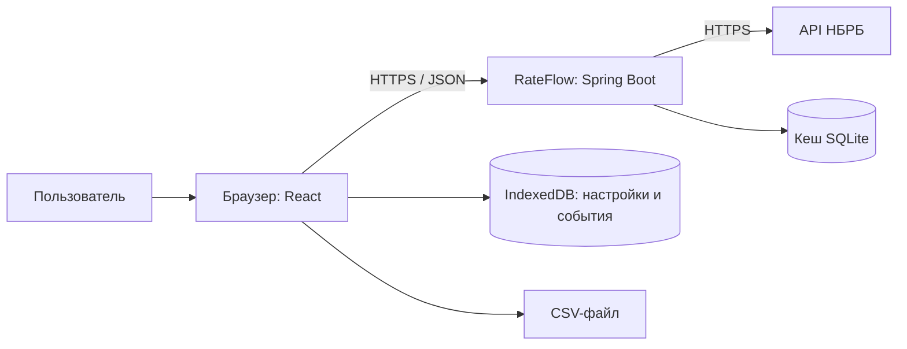
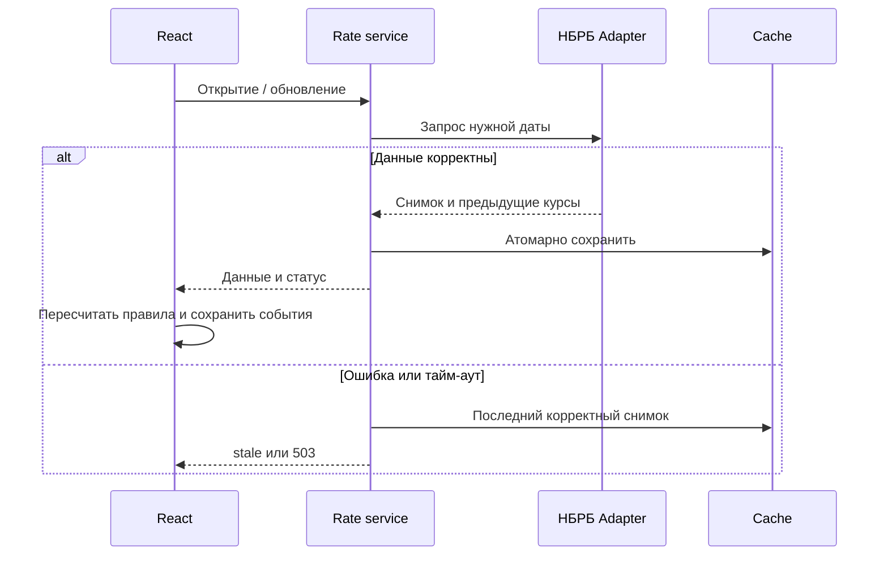

# Проектные представления RateFlow

Версия 0.2. Бурш Антон Павлович. Записи оформлены по view-template.md из main. Общее описание — [SDD](sdd.md), требования — [SRS](../srs.md).

# V01 — контекст

## Viewpoint

Context. Границы системы и внешние участники.

## Representation

Пользователь работает без регистрации. Сервер получает и проверяет внешние данные, браузер хранит предпочтения и события и считает пользовательские суммы локально. Закрытый браузер не получает уведомления. Источник используется только для официальных ежедневных курсов, не котировок покупки/продажи.

## Дополнительная информация

REQ-FUNC-001–007, REQ-SEC-001, REQ-AVAIL-001. ADR-0001/0002 в [adr.md](../adr/adr.md). Графики не входят в 0.2.

# V02 — композиция и зависимости

## Viewpoint

Composition, Structure, Dependency, Patterns.

## Representation

Backend: `provider` (Adapter НБРБ), `rates` (проверка и нормализация снимков), `cache` (Repository SQLite), `history` (исторические данные для графиков 0.3 и предшествующих курсов уведомлений), `diagnostics` (состояние обновления). Контроллер зависит от сервиса, сервис — от интерфейса источника/хранилища. Внешние DTO не передаются напрямую UI.

Frontend: страницы Rates, Converter, Notifications, Export; History — 0.3. Общие модули `api`, `decimal-calculation`, `preferences`, `alerts`, `storage`, `csv`. Alert engine использует нормализованные пары курсов, а не данные графика. Поэтому перенос графиков не отменяет получение предыдущей доступной даты для уведомлений. F03 зависит от F01; F05 — от F02; F06 — от F01/F05; F07 — от F01/F02. Общие формы и mock API позволяют junior работать до завершения backend.

**SYS-ARCH-001:** Модули расчётов должны быть чистыми функциями без HTTP и UI; единственная точка обращения к НБРБ — Provider. Проверка: ревью зависимостей и тесты расчётов без сети. Planned.

## Дополнительная информация

SRS §3.5.4, REQ-FUNC-003/006; ADR-0001/0003. Приоритеты и оценки — SDD §5.1; распределение команды — [P2](../correspondence.md).

# V03 — данные и хранение

## Viewpoint

Information, Logical.

## Representation

| Объект | Поля / инварианты |
|---|---|
| Rate | currency USD/EUR/RUB, positive scale, positive decimal rate, effectiveDate |
| Snapshot | id, effectiveDate, fetchedAt UTC, source, rates, stale; все курсы одной даты |
| Comparison | currency, currentDate/currentRate/scale, previousDate/previousRate/scale |
| Preferences | выбранные валюты, schemaVersion |
| AlertRule | currency unique, threshold 0,1–100%, enabled, revision |
| Notification | ruleRevision, currency, currentDate, previousDate, direction, rawChange, read |

Для BYN rate=1, scale=1. effectiveDate — календарная дата действия; «сегодня» определяется Europe/Minsk. fetchedAt — момент загрузки, не дата курса. Индекс кеша unique(currency,effectiveDate); снимок заменяется в транзакции SQLite только после полной проверки нужных валют и совпадения дат. Сохранённые снимки не содержат пользовательских сумм.

**SYS-RATE-001:** Будущие даты, неположительные значения и некорректные номиналы должны отклоняться. При отсутствии курса на сегодня используется последний корректный снимок с датой и признаком неподтверждённой актуальности; он не называется сегодняшним. Проверка: будущая дата, смешанные даты, scale=0. Planned.

**SYS-CACHE-001:** Последний корректный снимок должен сохраняться после перезапуска backend. Ошибка обновления не заменяет его частичным ответом. Проверка: ошибка/обрыв записи и перезапуск. Planned.

**SYS-STORE-001:** Preferences, правила, версия обработанного курса и последние 100 событий должны записываться в IndexedDB. Создание события и фиксация его уникального ключа — одна readwrite-транзакция. При отказе хранения UI показывает предупреждение и использует память до закрытия страницы. Очистка браузера удаляет локальные данные; синхронизации устройств нет. Проверки: перезагрузка, отказ/quota, две вкладки, смена схемы. Planned.

## Дополнительная информация

REQ-FUNC-001/002/005/006, REQ-REL-001; ADR-0002. Восстановление личных настроек после очистки браузера не обещается.

# V04 — интерфейсы

## Viewpoint

Interface. Контракт браузер/backend и локального экспорта.

## Representation

| Маршрут / операция | Контракт |
|---|---|
| GET /api/v1/rates | Полный текущий снимок, source, effectiveDate, fetchedAt, stale |
| POST /api/v1/rates/refresh | Запрос обновления общего кеша без пользовательского состояния |
| GET /api/v1/rates/comparison | Текущий и предыдущий доступные курсы по валютам; previous=null, если не найден |
| GET /api/v1/history?currency=&days= | 7/30/90 календарных дней, реализация 0.3 |
| buildCsv(snapshot,selectedCurrencies) | Blob CSV в браузере, без запроса суммы конвертера |

Десятичные значения JSON передаются строками, даты — YYYY-MM-DD, моменты загрузки — ISO 8601 UTC. Ошибка содержит code, message, correlationId. 400 — неверный параметр, 429 — ограничение частоты, 503 — источник недоступен и кеша нет. При сохранённом снимке GET возвращает 200 и stale=true, UI явно показывает предупреждение.

Точный внешний контракт НБРБ, идентификаторы валют, доступность истории, ограничения частоты и условия использования проверяются прототипом W00 до основной интеграции. Текущая документация не объявляет эту проверку завершённой. Неподдерживаемый ответ источника даёт контролируемую ошибку, не угаданные данные.

**SYS-SEC-001:** Поставка и обращения к НБРБ должны использовать HTTPS; API не принимает произвольный URL источника. Внешние строки выводятся как текст, HTML не исполняется. Реквизиты не запрашиваются, суммы не передаются backend. Проверка: XSS-строка, TLS, просмотр сети и логов. Planned.

**SYS-CSV-001:** CSV должен соответствовать REQ-FUNC-007: UTF-8 BOM, запятая, заголовок currency,nominal,rate_byn,effective_date,source,freshness; выбранные USD/EUR/RUB, опубликованный номинал и курс без округления до одной единицы; stale не скрывается. Выбор пуст — только заголовок. Кавычки удваиваются, значения со специальными символами заключаются в кавычки; опасные префиксы =,+,-,@, табуляция и CR предваряются апострофом. При готовом снимке генерация ≤1 с в 95/100 запусков на стенде V07. Нет снимка — экспорт отключён. Проверки формата/времени Planned.

## Дополнительная информация

REQ-FUNC-001/007, REQ-PERF-003, REQ-SEC-001/002, REQ-REL-001. ADR-0001/0004. Все данные примеров испытаний синтетические.

# V05 — обновление, состояния и параллелизм

## Viewpoint

Interaction, State Dynamics, Concurrency.

## Representation

**SYS-STATE-001:** UI должен поддерживать loading, fresh, stale, empty, error. Сохранённые данные не исчезают при обновлении; навигация и настройки доступны при отказе источника. Без снимка конвертер/экспорт отключены. Предельный бюджет внешней операции — 10 с; клиентский таймер отсчитывает те же 10 с от отправки, чтобы не ждать ответа дольше требования SRS. Повтор доступен по кнопке. Проверка: источник не отвечает, кеш есть/нет. Planned.

**SYS-SYNC-001:** Одновременные запросы обновления на сервере должны объединяться в одну операцию; автотаймер браузера запускается раз в 60 минут, пока приложение открыто. Ответ более старого запроса не заменяет более новый снимок; проверяются requestId, дата и fetchedAt. Две вкладки используют уникальный ключ события и транзакцию IndexedDB, исключая двойную запись. Проверки: гонка кнопки/таймера, обратный порядок ответов, две вкладки. Planned.

## Дополнительная информация

REQ-FUNC-001/006, REQ-REL-001, REQ-AVAIL-001; ADR-0002/0003. Уведомления не отправляются в закрытый браузер. При следующем открытии сравнивается последний доступный курс с предыдущей доступной датой; пропущенные за время закрытия промежуточные события не восстанавливаются пачкой.

# V06 — конвертация, графики и уведомления

## Viewpoint

Algorithm.

## Representation

**SYS-CALC-001:** Расчёт должен выполняться десятичной арифметикой: result=amount×(sourceRate/sourceScale)/(targetRate/targetScale), BYN=1/1. Во frontend применяется decimal-библиотека с точностью не менее 34 значащих цифр; на backend денежные значения представляются BigDecimal. IEEE float для финансовых значений не используется. Для положительных курсов и номиналов деление определено; курсы разных дат не смешиваются. Ввод 0–1 000 000 000, максимум два десятичных знака, запятая/точка; результат half-up до двух знаков, исходные курсы не округляются заранее. При загруженных данных 95/100 пересчётов ≤200 мс. Проверка: 10 USD→857,14 RUB при синтетических 1 USD=3 BYN, 100 RUB=3,5 BYN, границы/ошибки/даты. Planned.

**SYS-ALERT-001:** Alert engine должен нормализовать обе даты отдельно (rate/scale) и считать change=(new−old)/old×100. Сравнение abs(change) с threshold выполняется до округления; событие создаётся при равенстве порогу. Нет previous — нет события. Ключ unique(currency,currentDate,ruleRevision) предотвращает повтор для той же версии правила; изменение порога/включения создаёт новую revision. События сохраняются после успешного получения актуальной последовательности, повтор stale-снимка не создаёт новых событий. Проверки: 3→3,06 и 3→2,94 при 2%, 3→3,059, смена номинала, повтор, две вкладки, прочтение/очистка, обрезка до 100. Planned.

**SYS-HIST-001 (Deferred 0.3):** История должна строиться за последние 7/30/90 календарных дней до сегодняшней даты Europe/Minsk, с нормализацией до одной единицы валюты. Нет данных — пустое состояние; одна точка — без процента; пропуски не заменяются нулём. Процент считается между первым и последним доступными значениями. Это отложенная визуализация: получение предыдущего курса для SYS-ALERT-001 остаётся в 0.2.

## Дополнительная информация

REQ-FUNC-003/004/006, REQ-PERF-002; ADR-0003. Направление изменения показывается текстом/знаком, а не только цветом. Данные и тесты — справочные, прогнозирования и рекомендаций нет.

# V07 — развёртывание и ресурсы

## Viewpoint

Physical, Deployment, Resources.

## Representation

Учебный стенд: Linux, 2 vCPU, 4 ГиБ RAM, 10 ГиБ диска; reverse proxy со статикой React, один Spring Boot JVM, SQLite на постоянном томе. Предлагаются Java 21 и TypeScript; точные версии библиотек фиксируются при реализации после проверки совместимости и доступности обновлений. Это проектный выбор, не утверждение об актуальных версиях. Backend и UI поставляются воспроизводимой сборкой, конфигурация — через окружение без секретов в Git. Аккаунты и PostgreSQL для личных данных не требуются.

**SYS-DEP-001:** Документация реализации должна содержать команды сборки/запуска, health-check и путь тома кеша. После перезапуска сохраняется последний корректный снимок; кеш заменяется транзакционно. SQLite-копия выполняется штатным механизмом backup, не копированием открытого файла. Проверки: чистая установка и восстановление кеша. Planned.

**SYS-PERF-001:** При доступном API, сети ≥10 Мбит/с и 20 одновременных пользователях 95/100 загрузок страницы должны укладываться в 3 с. Устройство, браузер, RTT и состояние кеша фиксируются в протоколе; отдельно измеряются холодный и прогретый кеш. Недоступный API проверяется как отказ по тайм-ауту, не как успешная загрузка за 3 с. Planned.

**SYS-OBS-001:** Backend должен фиксировать время/результат обновления, дату последнего корректного курса и code/correlationId интеграционной ошибки; UI показывает время и дату отдельно. Суммы конвертации не включаются в сообщения. Проверки: инспекция журналов и статусов. Planned.

Объём локального журнала — последние 100 событий, три правила и предпочтения. Сервер объединяет одинаковые внешние запросы и использует кеш; частота ограничивается после проверки допустимой нагрузки источника в W00. Гарантированный круглосуточный SLA не вводится. Командные ресурсы и резерв рассчитаны в P2.

## Дополнительная информация

REQ-PERF-001–003, REQ-AVAIL-001, REQ-OBS-001, SRS §3.5; ADR-0001/0002/0004. Планы и критерии демонстрации — [correspondence.md](../correspondence.md).
