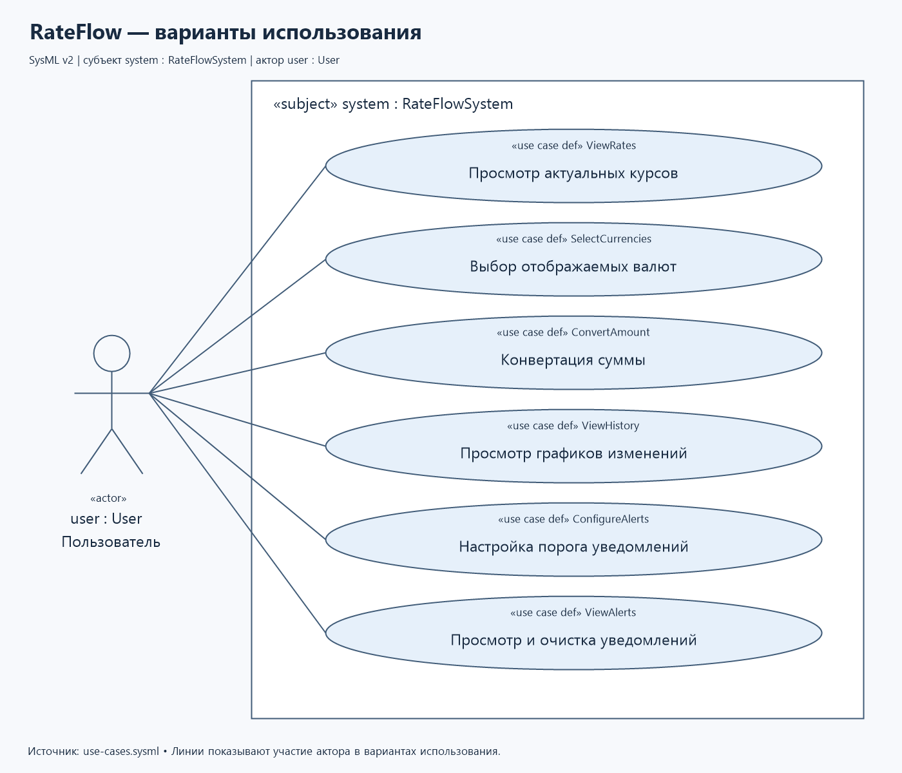
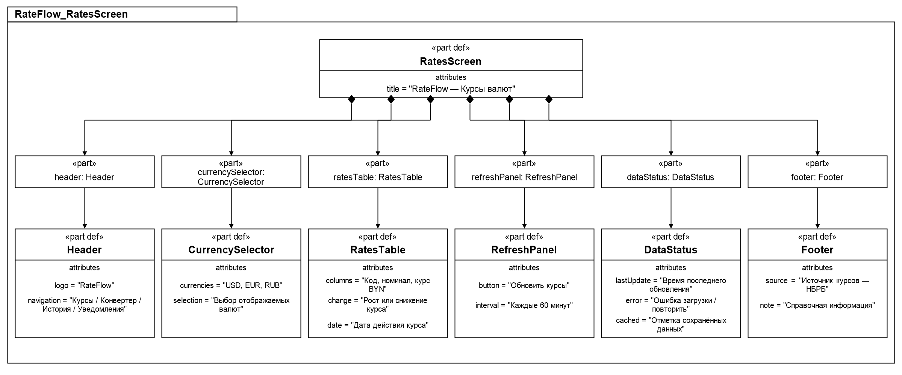
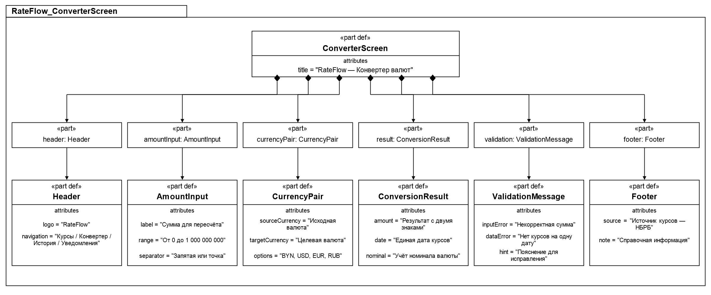
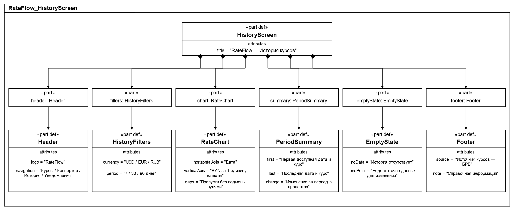
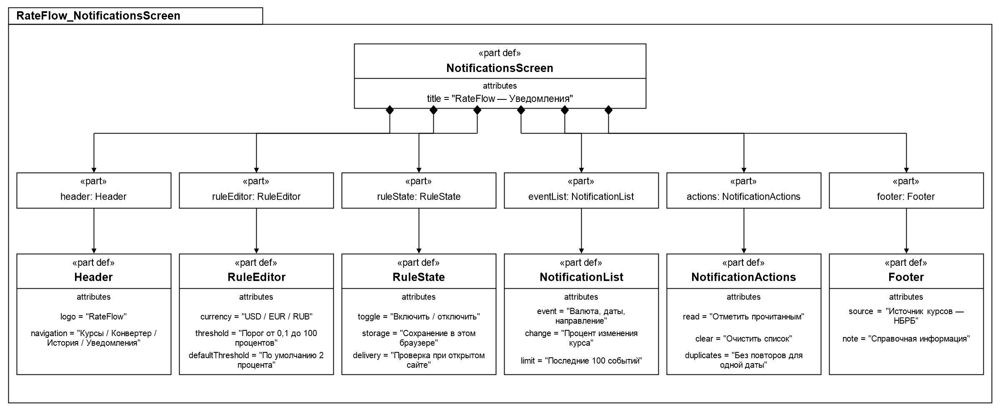
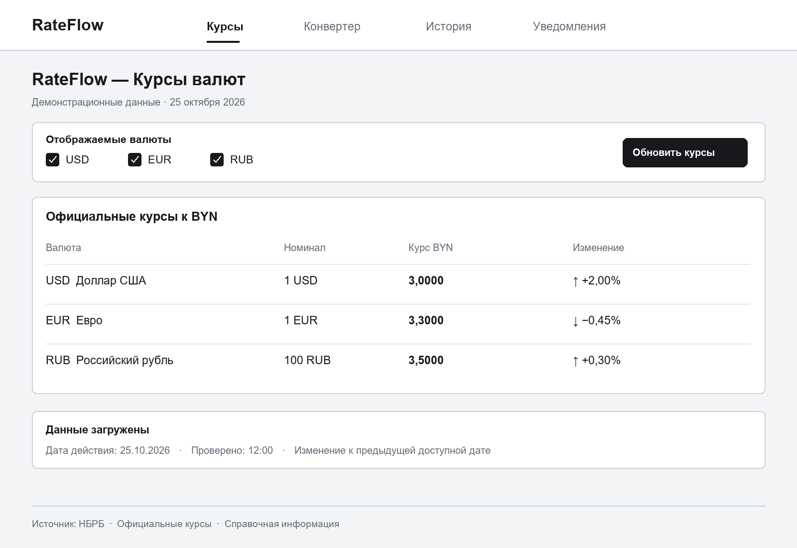
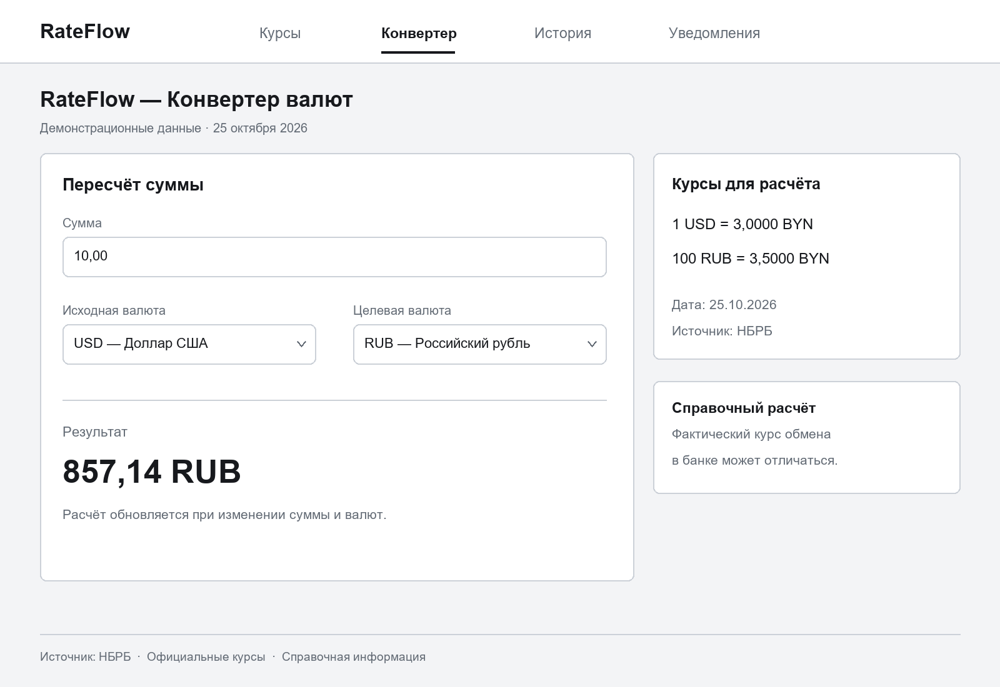
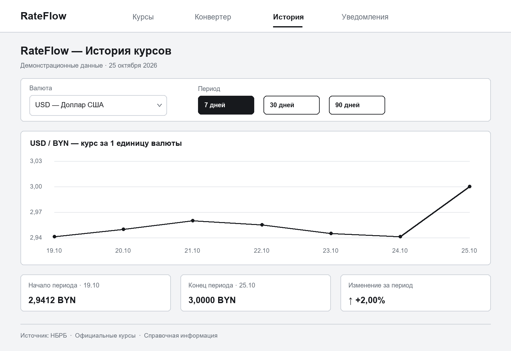
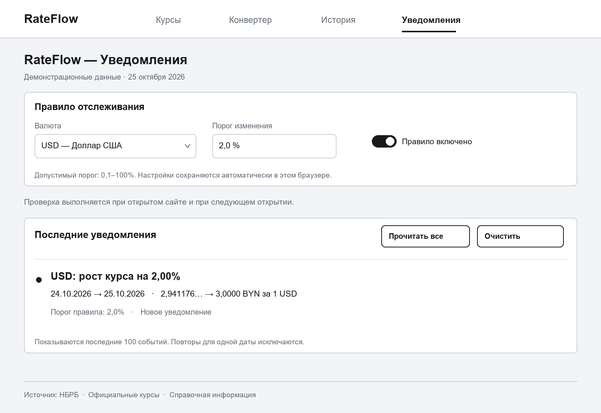

# Спецификация требований к ПО

Для RateFlow

Версия 0.1

Подготовил Бурш Антон Павлович

БГУИР

25 октября 2026 г.

## Оглавление

* [1. Введение](#introduction)
  * [1.1 Назначение документа](#document-purpose)
  * [1.2 Область применения продукта](#product-scope)
  * [1.3 Определения, акронимы и сокращения](#definitions)
  * [1.4 Ссылки](#references)
  * [1.5 Обзор документа](#document-overview)
* [2. Обзор продукта](#product-overview)
  * [2.1 Перспектива продукта](#product-perspective)
  * [2.2 Функции продукта](#product-functions)
  * [2.3 Ограничения продукта](#product-constraints)
  * [2.4 Характеристики пользователей](#user-characteristics)
  * [2.5 Допущения и зависимости](#assumptions)
  * [2.6 Распределение требований](#apportioning)
* [3. Требования](#requirements)
  * [3.1 Внешние интерфейсы](#external-interfaces)
  * [3.2 Функциональные требования](#functional)
  * [3.3 Качество обслуживания](#quality)
  * [3.4 Соответствие стандартам](#compliance)
  * [3.5 Проектирование и реализация](#implementation)
  * [3.6 ИИ/МО](#aiml)
* [4. Верификация](#verification)
* [5. Приложения](#appendixes)

## История изменений

| Name | Date | Reason For Changes | Version |
|------|------|--------------------|---------|
| Бурш Антон Павлович | 25.10.2026 | Первоначальная разработка документа для RateFlow | 0.1 |

---

## 1. Введение

### 1.1 Назначение документа

Настоящий документ (SRS) определяет требования к веб-приложению мониторинга курсов валют RateFlow. Документ предназначен для заказчика, разработчика и тестировщика. SRS определяет, что должна делать система, и служит основой для согласования требований, проектирования, реализации и проверки результата.

### 1.2 Область применения продукта

RateFlow — веб-приложение для просмотра актуальных официальных курсов валют, конвертации сумм, анализа истории и получения уведомлений о резких изменениях курса. Приложение предназначено для путешественников, покупателей зарубежных товаров и пользователей, планирующих расходы в разных валютах.

Бизнес-цели продукта:

- **BR-1:** Сократить время поиска курсов выбранных валют, объединив информацию в одном интерфейсе.
- **BR-2:** Упростить пересчёт стоимости покупок и планирование расходов в разных валютах.
- **BR-3:** Предоставить наглядную историю изменений для сравнения курсов за выбранный период.
- **BR-4:** Снизить необходимость ручной проверки курсов с помощью уведомлений о существенных изменениях.

В первую версию входят BYN, USD, EUR и RUB. Приложение использует официальные ежедневные курсы к BYN. Обмен валют, банковские переводы, сравнение курсов покупки и продажи в банках и прогнозирование курсов не входят в область проекта.

### 1.3 Определения, акронимы и сокращения

| Term | Definition |
|------|------------|
| API | Программный интерфейс для получения данных внешнего сервиса |
| BR | Business Requirement — бизнес-требование |
| BYN | Белорусский рубль, базовая валюта расчётов |
| MVP | Minimum Viable Product — первая версия с минимальным набором функций |
| SRS | Software Requirements Specification — спецификация требований к ПО |
| Номинал | Количество единиц валюты, за которое указан официальный курс |
| Актуальный курс | Официальный курс, действующий на текущую дату в часовом поясе Europe/Minsk |
| Резкий скачок | Изменение курса к BYN относительно предыдущей доступной даты, модуль которого не меньше порога пользователя |

### 1.4 Ссылки

1. Шаблон SRS из основной ветки учебного репозитория, подготовленного в лабораторной работе №2.
2. Задание лабораторной работы №3 «Разработка и документирование бизнес-требований».
3. [Документация API Национального банка Республики Беларусь](https://www.nbrb.by/apihelp/exrates) — предполагаемый источник официальных курсов и исторических данных.
4. [SysML v2, OMG](https://www.omg.org/spec/SysML/2.0/) — описание языка графической части.

### 1.5 Обзор документа

Раздел 2 описывает назначение продукта, функции, пользователей и ограничения. Раздел 3 содержит функциональные и нефункциональные требования. Раздел 4 определяет методы проверки. Раздел 5 описывает графическую часть и порядок согласования требований.

---

## 2. Обзор продукта

### 2.1 Перспектива продукта

RateFlow является самостоятельным информационным сервисом, объединяющим курсы, конвертер, историю и уведомления. Система получает данные из внешнего API НБРБ и предоставляет их пользователю через браузер. Официальные курсы обновляются согласно данным источника; продукт не предназначен для отслеживания биржевых котировок в реальном времени.

Предпочтительный стек для последующей реализации: Java Spring Boot для backend и React для frontend. Окончательный выбор технологий согласуется с преподавателем.

### 2.2 Функции продукта

- Просмотр официальных курсов USD, EUR и RUB к BYN с указанием даты, номинала и источника.
- Выбор отображаемых валют и сохранение предпочтений.
- Конвертация между поддерживаемыми валютами.
- Построение графиков изменений за 7, 30 и 90 дней.
- Настройка порогов резкого изменения курса.
- Просмотр уведомлений о росте и снижении курса внутри приложения.

### 2.3 Ограничения продукта

- Приложение должно быть адаптивным веб-приложением с русскоязычным интерфейсом.
- Для загрузки новых курсов и истории требуется подключение к Интернету.
- Данные должны поступать из официального внешнего источника; доступность необходимых данных проверяется до реализации.
- Курсы являются справочными и не гарантируют возможность обмена по указанной цене.
- Уведомления в MVP создаются при открытом приложении и при следующем открытии; фоновая доставка при закрытом браузере не предусмотрена.
- Регистрация и синхронизация между устройствами не входят в первую версию.

### 2.4 Характеристики пользователей

- **Пользователь:** человек с базовыми навыками работы с браузером, которому нужны курсы для поездок, покупок или планирования расходов. Ожидает быстрого доступа к информации, понятного конвертера и наглядных графиков.
- **Разработчик:** отвечает за интеграцию с источником данных, исправление ошибок и обновление приложения. Отдельная административная панель в MVP не требуется.

### 2.5 Допущения и зависимости

- Предполагается, что API НБРБ предоставляет курсы выбранных валют и историю за необходимые периоды. Это допущение необходимо проверить до реализации.
- Пользователь работает в браузере с поддержкой JavaScript и локального хранения настроек.
- Очистка данных браузера может удалить настройки и историю уведомлений. При недоступном локальном хранении настройки действуют до закрытия страницы.
- При недоступности источника приложение показывает сохранённые данные с соответствующей отметкой либо сообщает об отсутствии данных.

### 2.6 Распределение требований

В MVP входят просмотр курсов, выбор валют, конвертер, графики и уведомления внутри приложения. Аккаунты, фоновые push-уведомления, дополнительные источники и сравнение банковских курсов могут рассматриваться в следующих версиях.

---

## 3. Требования

### 3.1 Внешние интерфейсы

#### 3.1.1 Пользовательские интерфейсы

Веб-интерфейс должен поддерживать работу на компьютере, планшете и смартфоне. Основные экраны:

- **RatesScreen:** выбор валют, таблица курсов, номиналы, дата действия, источник и кнопка обновления.
- **ConverterScreen:** ввод суммы, выбор исходной и целевой валюты, результат и дата расчёта.
- **HistoryScreen:** выбор валюты и периода, график курса и изменение за период.
- **NotificationsScreen:** выбор валюты, настройка порога, включение правила и список уведомлений.

Навигация между экранами должна быть доступна на каждой странице. Направление изменения курса должно обозначаться знаком или текстом, а не только цветом.

#### 3.1.2 Аппаратные интерфейсы

Специализированное оборудование не требуется. Используются стандартные средства ввода устройства: клавиатура, мышь или сенсорный экран.

#### 3.1.3 Программные интерфейсы

- Интеграция с API НБРБ для получения официальных курсов и истории.
- Предполагаемое взаимодействие frontend и backend — REST API с данными JSON.
- Для каждого курса должны учитываться код валюты, номинал, значение и дата действия. Записи с некорректной датой, неположительным курсом или номиналом должны отклоняться.

### 3.2 Функциональные требования

**REQ-FUNC-001: Просмотр актуальных курсов**

- **Statement:** Система должна показывать официальные курсы USD, EUR и RUB к BYN с указанием номинала, даты действия и источника. Обновление выполняется при открытии приложения, по кнопке и каждые 60 минут, пока приложение открыто. Курс на будущую дату не должен отображаться как действующий сегодня.
- **Rationale:** Быстрый доступ к валютной информации (BR-1).
- **Verification Method:** Demonstration, Test.

**REQ-FUNC-002: Выбор валют**

- **Statement:** Система должна позволять выбирать отображаемые валюты из USD, EUR и RUB и сохранять выбор в текущем браузере. При пустом выборе должно отображаться предложение выбрать валюту.
- **Rationale:** Отображение только нужной пользователю информации (BR-1).
- **Verification Method:** Test.

**REQ-FUNC-003: Конвертация валют**

- **Statement:** Система должна пересчитывать сумму между BYN, USD, EUR и RUB по курсам одной даты с учётом номинала. Формула: `результат = сумма × (курс исходной валюты / её номинал) / (курс целевой валюты / её номинал)`; для BYN курс и номинал равны 1. Допускается сумма от 0 до 1 000 000 000 с двумя десятичными знаками и разделителем «,» или «.». Некорректный ввод должен сопровождаться ошибкой. Итог округляется до двух знаков по правилу half-up; дата расчёта показывается рядом с результатом.
- **Rationale:** Упрощение расчёта расходов (BR-2).
- **Verification Method:** Test.

**REQ-FUNC-004: Графики изменений**

- **Statement:** Система должна строить график курса выбранной иностранной валюты к BYN за последние 7, 30 или 90 календарных дней. Значения отображаются за одну единицу валюты. Должны быть указаны даты, первый и последний доступные курсы и процент изменения между ними. Отсутствующие данные не должны заменяться нулём; при одной точке изменение не рассчитывается.
- **Rationale:** Наглядное сравнение исторических данных (BR-3).
- **Verification Method:** Demonstration, Test.

**REQ-FUNC-005: Настройка уведомлений**

- **Statement:** Система должна позволять создавать по одному правилу для USD, EUR и RUB, задавать порог от 0,1% до 100% с шагом 0,1%, включать и отключать правило. Порог по умолчанию — 2%. Настройки должны сохраняться в текущем браузере.
- **Rationale:** Настройка отслеживания существенных изменений под потребности пользователя (BR-4).
- **Verification Method:** Test.

**REQ-FUNC-006: Уведомления о резких скачках**

- **Statement:** После успешного обновления система должна сравнить нормализованный курс с курсом предыдущей доступной даты. Если `abs((новый курс − предыдущий курс) / предыдущий курс × 100)` не меньше порога активного правила, должно появиться уведомление с валютой, датами, направлением и процентом изменения. Сравнение выполняется до округления. При отсутствии предыдущего курса уведомление не создаётся. Повторное получение той же даты не должно создавать дубликат по тому же правилу в текущем браузере. Пользователь должен иметь возможность отмечать события прочитанными и очищать список; сохраняются последние 100 событий.
- **Rationale:** Уменьшение необходимости вручную отслеживать курсы (BR-4).
- **Verification Method:** Test.

### 3.3 Качество обслуживания

#### 3.3.1 Производительность

- **REQ-PERF-001:** При доступном API, соединении от 10 Мбит/с и 20 одновременных пользователях 95% из 100 загрузок страницы курсов должны завершаться не более чем за 3 секунды. Устройство и браузер фиксируются в протоколе проверки.
- **REQ-PERF-002:** При уже загруженных курсах результат конвертации должен появляться не более чем за 200 мс в 95% из 100 измерений.

#### 3.3.2 Безопасность

- **REQ-SEC-001:** Опубликованное приложение и получение внешних данных должны использовать HTTPS.
- **REQ-SEC-002:** Пользовательский ввод и значения из API должны обрабатываться как данные без выполнения HTML или сценариев. Система не должна запрашивать платёжные реквизиты.

#### 3.3.3 Надёжность

- **REQ-REL-001:** При ошибке источника или превышении времени ожидания 10 секунд система должна показать сообщение и возможность повтора. Последние корректные данные и настройки должны сохраняться. Сохранённые курсы должны обозначаться как данные с неподтверждённой актуальностью и сопровождаться датой; при отсутствии курсов расчёты недоступны.

#### 3.3.4 Доступность

- **REQ-AVAIL-001:** При отказе API в уже открытом приложении должны оставаться доступны навигация, настройки и просмотр сохранённых данных. Гарантированная круглосуточная доступность для учебного MVP не устанавливается.

#### 3.3.5 Наблюдаемость

- **REQ-OBS-001:** Система должна фиксировать время и результат последнего обновления, дату последнего успешно полученного курса и ошибки интеграции. Введённые пользователем суммы не должны включаться в диагностические сообщения.

### 3.4 Соответствие стандартам

Документ оформляется по структуре учебного шаблона SRS. Для валют используются обозначения BYN, USD, EUR и RUB. Дата действия курса должна отличаться от времени загрузки данных. Условия использования внешнего API необходимо проверить перед подключением.

### 3.5 Проектирование и реализация

#### 3.5.1 Установка

Пользователь должен получать доступ через браузер без установки отдельного приложения. Инструкция запуска сервера добавляется на этапе реализации.

#### 3.5.2 Сборка и поставка

Исходные материалы хранятся в Git. Требования разрабатываются в отдельной ветке `business-requirements`; проверка и согласование выполняются через pull request.

#### 3.5.4 Сопровождаемость

При реализации следует разделить получение внешних данных, расчёты, правила уведомлений и отображение. Изменения требований должны сохранять их идентификаторы и отражаться в истории документа.

### 3.6 ИИ/МО

Не применяется для текущей версии MVP. Прогнозирование курсов и автоматические финансовые рекомендации не предусмотрены.

---

## 4. Верификация

Проверки запланированы для этапа реализации. Числа в сценариях ниже — синтетические тестовые данные, а не текущие курсы.

| Requirement ID | Verification Method | Сценарий проверки | Status | Evidence |
|----------------|---------------------|-------------------|--------|----------|
| REQ-FUNC-001 | Demonstration, Test | Проверить валюты, номиналы, дату, источник, кнопку обновления, период 60 минут и исключение будущей даты | Planned | — |
| REQ-FUNC-002 | Test | Изменить выбор, перезагрузить страницу, проверить сохранение и пустой список | Planned | — |
| REQ-FUNC-003 | Test | При 1 USD = 3 BYN и 100 RUB = 3,5 BYN проверить: 10 USD → 857,14 RUB; проверить одинаковые валюты, нулевую сумму, ошибочный ввод и несовпадение дат | Planned | — |
| REQ-FUNC-004 | Demonstration, Test | Проверить периоды 7/30/90 дней, номинал, пустую историю, одну точку и пропущенные даты; курс 3 → 3,06 должен давать +2% | Planned | — |
| REQ-FUNC-005 | Test | Проверить границы порога, включение, отключение и сохранение правил | Planned | — |
| REQ-FUNC-006 | Test | При пороге 2% изменения 3 → 3,06 и 3 → 2,94 создают уведомления, а 3 → 3,059 — нет; проверить дубликаты, прочтение и очистку | Planned | — |
| REQ-PERF-001–002 | Test | Выполнить измерения времени загрузки и пересчёта в заданных условиях | Planned | — |
| REQ-SEC-001–002 | Inspection, Test | Проверить HTTPS, отсутствие запроса реквизитов и невозможность исполнения введённого HTML | Planned | — |
| REQ-REL-001, REQ-AVAIL-001 | Test | Смоделировать отказ API и тайм-аут с сохранёнными данными и без них | Planned | — |
| REQ-OBS-001 | Inspection | Проверить состав статусов и сообщений об ошибках | Planned | — |

---

## 5. Приложения

Графическая часть включает модель вариантов использования и структурный прототип экранов RatesScreen, ConverterScreen, HistoryScreen и NotificationsScreen. Исходники SysMLv2 и изображения размещены в папке [diagrams](diagrams/README.md). PNG подготовлены локальным скриптом визуализации моделей; проверка специализированным компилятором SysMLv2 не выполнялась.

*Рисунок 1 — Варианты использования RateFlow. [Исходник SysMLv2](diagrams/use-cases.sysml).*

*Рисунок 2 — Структурный прототип страницы курсов. [Исходник SysMLv2](diagrams/rates-page.sysml).*

*Рисунок 3 — Структурный прототип конвертера. [Исходник SysMLv2](diagrams/converter-page.sysml).*

*Рисунок 4 — Структурный прототип истории курсов. [Исходник SysMLv2](diagrams/history-page.sysml).*

*Рисунок 5 — Структурный прототип уведомлений. [Исходник SysMLv2](diagrams/notifications-page.sysml).*

### Визуальные мокапы интерфейса

Следующие изображения дополняют модели SysMLv2 и показывают предполагаемое размещение элементов на экранах. Мокапы статические, данные вымышленные. Они созданы отдельным скриптом Python по составу экранов; это не экспорт из редактора SysMLv2. [Описание и способ пересоздания](diagrams/mockups/README.md).

*Рисунок 6 — Мокап страницы курсов валют.*

*Рисунок 7 — Мокап конвертера валют.*

*Рисунок 8 — Мокап истории курсов с графиком.*

*Рисунок 9 — Мокап настройки правил и просмотра уведомлений.*

Требования версии 0.1 являются проектом для обсуждения с заказчиком. После ролевой игры с назначенным напарником необходимо уточнить выбранные валюты, периоды истории, пороги уведомлений и технические ограничения. Реальные замечания напарника и преподавателя оформляются в pull request; для принятых и отклонённых предложений фиксируются решение и обоснование. Перед сдачей необходимо оформить отчёт по действующим требованиям СТП БГУИР.
