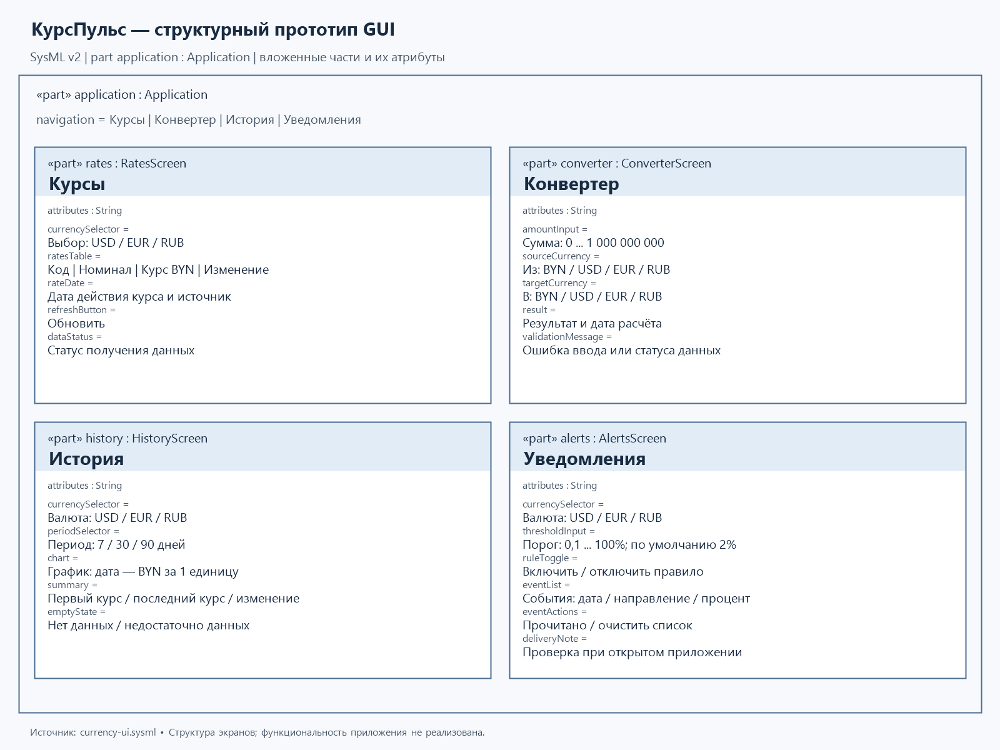

# Спецификация требований к ПО

Для веб-приложения «КурсПульс» — курсы валют

Версия 0.1 · БГУИР · 25 октября 2026 г.

Автор: ФИО студента необходимо заполнить перед сдачей.

Статус: проект требований для обсуждения с заказчиком. Название, тип приложения, источник данных и количественные критерии предложены разработчиком и требуют согласования с напарником и преподавателем.

## Оглавление

1. [Введение](#1-введение)
2. [Обзор продукта](#2-обзор-продукта)
3. [Требования](#3-требования)
4. [Верификация](#4-верификация)
5. [Приложения](#5-приложения)

## История изменений

| Автор | Дата | Причина изменения | Версия |
|---|---|---|---|
| Студент | 25.10.2026 | Подготовлен первоначальный проект требований | 0.1 |

## 1. Введение

### 1.1 Назначение документа

SRS определяет бизнес-цели и требования к приложению «КурсПульс». Документ предназначен для заказчика, разработчика и проверяющего: он используется для согласования границ проекта, разработки и приёмки. Приложение в рамках лабораторной №3 не реализуется.

### 1.2 Область применения продукта

«КурсПульс» — русскоязычное веб-приложение для людей, планирующих расходы в разных валютах: путешественников, покупателей зарубежных товаров и пользователей с валютными сбережениями. Оно объединяет просмотр официальных курсов, пересчёт сумм, изучение истории и уведомления о существенном изменении курса.

Первая версия охватывает ежедневные официальные курсы к белорусскому рублю (BYN), валюты USD, EUR и RUB. Пользователь выбирает отображаемые валюты из этого набора. Приложение не выполняет обменные операции, не сравнивает предложения банков и не прогнозирует доходность. Конвертация является справочным расчётом по официальным курсам.

**Бизнес-цели и предполагаемые критерии достижения:**

| ID | Цель | Критерий приёмки |
|---|---|---|
| BR-01 | Сократить время поиска курса нужной валюты | Пользователь находит курс, дату и источник за 30 секунд в демонстрационном сценарии |
| BR-02 | Упростить расчёт валютных расходов | Пересчёт суммы между поддерживаемыми валютами выполняется в одном окне без ручного поиска курса |
| BR-03 | Помочь оценивать изменения курса | Пользователь получает график за 7, 30 или 90 дней и изменение за выбранный период |
| BR-04 | Сократить необходимость вручную отслеживать скачки | При достижении настроенного порога появляется однократное уведомление для соответствующей даты курса |

### 1.3 Определения, акронимы и сокращения

| Термин | Определение |
|---|---|
| API | Программный интерфейс внешнего источника данных |
| BYN | Белорусский рубль, базовая валюта расчётов |
| MVP | Первая версия с минимальным согласованным набором функций |
| SRS | Спецификация требований к программному обеспечению |
| Актуальный курс | Курс источника, действующий на текущую календарную дату в часовом поясе Europe/Minsk |
| Номинал | Число единиц иностранной валюты, за которое указан курс в BYN |
| Резкий скачок | Изменение нормализованного курса к BYN относительно предыдущей доступной даты, модуль которого не меньше порога пользователя |

### 1.4 Ссылки

- Основа документа: [локальный шаблон SRS](srs-template.md).
- Задание лабораторной №3 «Разработка и документирование бизнес-требований», предоставленное преподавателем через студента; обязательный источник условий работы.
- [Пример оформления FinHall](https://github.com/luckyPerson06/SDLC/blob/business-requirements/srs-template.md) — справочный образец структуры.
- [Документация API Национального банка Республики Беларусь](https://www.nbrb.by/apihelp/exrates) — предполагаемый источник курсов; доступность и формат необходимо проверить на этапе доказательства концепции.
- [Спецификация SysML v2, OMG](https://www.omg.org/spec/SysML/2.0/) — справочный источник нотации моделей.

### 1.5 Обзор документа

Раздел 2 описывает пользователей, ограничения и состав первой версии. Раздел 3 определяет проверяемое поведение системы. Раздел 4 содержит план приёмки, раздел 5 — ссылки на графическую модель и материалы лабораторной. Изменения фиксируются с сохранением идентификаторов требований.

## 2. Обзор продукта

### 2.1 Перспектива продукта

Приложение является самостоятельным информационным сервисом. Пользователь взаимодействует с ним через браузер; внешний источник предоставляет официальные курсы и историю. Официальный курс не является обещанием обмена по такой цене. Источник и дата действия курса должны быть видны рядом с данными.

### 2.2 Функции продукта

- Просмотр курсов USD, EUR и RUB к BYN с номиналом, датой и изменением.
- Выбор отображаемых валют.
- Конвертация между BYN и поддерживаемыми иностранными валютами, включая пересчёт через BYN.
- Просмотр истории и графика за 7, 30 и 90 календарных дней.
- Настройка порога изменения отдельно для каждой иностранной валюты.
- Получение уведомлений внутри открытого приложения.
- Сохранение выбора валют и правил уведомлений в текущем браузере.

### 2.3 Ограничения продукта

Продукт должен предоставляться как адаптивное веб-приложение на русском языке. Источником должны быть официальные ежедневные данные НБРБ; биржевые котировки в реальном времени не входят в область проекта. Получение новых данных требует доступа к Интернету. Учётные записи и уведомления при закрытом приложении не входят в MVP. Описание требований выполняется в Markdown, графическая модель — на SysMLv2 с сохранением PNG. Язык разработки и фреймворк пока не определены и выбираются при согласовании технической части.

### 2.4 Характеристики пользователей

| Роль | Потребность | Подготовка |
|---|---|---|
| Пользователь | Узнать курс, пересчитать расходы, оценить динамику, получить уведомление | Базовые навыки работы с браузером |
| Заказчик — напарник, затем преподаватель | Согласовать цели, проверить сценарии, предложить изменения | Знание потребностей целевой аудитории |
| Разработчик | Поддерживать получение данных и соответствие требованиям | Навыки веб-разработки и работы с Git |

Административная панель в первой версии не требуется.

### 2.5 Допущения и зависимости

| Допущение / зависимость | Риск | Реакция |
|---|---|---|
| API предоставляет выбранные валюты и историю | Нет курса или изменился формат | Сообщить об отсутствии данных, не подменять их нулём |
| Ежедневных данных достаточно для целей пользователя | Заказчику нужны внутридневные колебания | Пересмотреть источник и границы через изменение SRS |
| Пользователь разрешает локальное хранение | Настройки теряются после очистки браузера | Описать ограничение; при недоступности хранения работать до закрытия страницы |
| Приложение открыто для получения уведомлений | Пользователь ожидает фоновую доставку | Явно указать ограничение в настройках уведомлений |

### 2.6 Распределение требований

| Этап | Объём |
|---|---|
| Лабораторная №3 | Сбор и документирование требований, модель GUI, PNG, рецензирование |
| Первая реализуемая версия | Все требования REQ-FUNC-001–010 и требования качества из раздела 3.3 |
| Возможное развитие, вне обязательств версии 0.1 | Фоновые push-уведомления, аккаунты, дополнительные валюты, курсы банков |

## 3. Требования

### 3.1 Внешние интерфейсы

#### 3.1.1 Пользовательские интерфейсы

**REQ-INT-001.** Система должна предоставлять экраны «Курсы», «Конвертер», «История» и «Уведомления» с общей навигацией. При ширине окна от 360 до 1440 пикселей элементы ввода и основной текст должны помещаться без горизонтальной прокрутки страницы. Изменение курса должно обозначаться знаком и текстом, а не только цветом.

На экране «Курсы» расположены выбор валют, таблица курсов, дата, источник и статус обновления. В конвертере — сумма, две валюты, результат и дата расчёта. В истории — валюта, период, график и числовая сводка. В уведомлениях — валюта, порог, переключатель правила и список событий.

Рисунок 1 — Структурная модель экранов. [Текстовая модель SysMLv2](diagrams/currency-ui.sysml). Числовые примеры для приёмки ниже являются синтетическими.

#### 3.1.2 Аппаратные интерфейсы

Специализированное оборудование не требуется. Ввод осуществляется клавиатурой, мышью или сенсорным экраном.

#### 3.1.3 Программные интерфейсы

**REQ-INT-002.** Интеграция с источником должна получать код валюты, номинал, курс и дату действия. Для истории должны извлекаться датированные значения. Формат и ограничения запросов фиксируются после проверки документации API. Полученные записи с отсутствующим кодом, неверной датой, неположительным курсом или номиналом должны отклоняться с фиксацией ошибки.

### 3.2 Функциональные требования

Все требования раздела обязательны для первой версии; способы проверки приведены в разделе 4.

| ID | Требование | Обоснование |
|---|---|---|
| REQ-FUNC-001 | Система должна показывать USD, EUR и RUB к BYN: код, название, номинал, курс, дату действия и источник. BYN должен иметь расчётный курс 1 за 1 единицу. | BR-01 |
| REQ-FUNC-002 | Пользователь должен иметь возможность включать и исключать поддерживаемые иностранные валюты из списка. Пустой выбор должен сопровождаться предложением выбрать валюту. Выбор должен сохраняться в текущем браузере при доступном локальном хранении. | BR-01 |
| REQ-FUNC-003 | При открытии приложения и по кнопке «Обновить» система должна запрашивать данные на текущую дату Europe/Minsk. Пока страница открыта, проверка должна повторяться каждые 60 минут. Данные на будущую дату нельзя показывать как действующие сегодня. | BR-01 |
| REQ-FUNC-004 | Конвертер должен принимать сумму от 0 до 1 000 000 000 включительно с не более чем двумя десятичными знаками, разделителем «,» или «.», и две поддерживаемые валюты. Пустой ввод, отрицательная сумма, буквы и превышение диапазона должны давать понятную ошибку без результата. | BR-02 |
| REQ-FUNC-005 | Пересчёт должен выполняться по формуле S × (R_A / N_A) / (R_B / N_B), где R — курс в BYN за номинал N. Курсы обеих валют должны относиться к одной дате. Результат должен округляться до двух десятичных знаков по правилу half-up только после вычисления. При одинаковых валютах результат равен исходной сумме. | BR-02 |
| REQ-FUNC-006 | Система должна показывать график нормализованного курса (BYN за 1 единицу) выбранной иностранной валюты за последние 7, 30 или 90 календарных дней включительно до текущей даты. График должен содержать оси даты и курса; отсутствующие значения нельзя заменять нулём или выдуманными точками. При отсутствии данных должно выводиться сообщение. | BR-03 |
| REQ-FUNC-007 | Рядом с графиком система должна показывать первую и последнюю доступные даты периода, соответствующие курсы и изменение 100 × (r_last − r_first) / r_first. При одной точке изменение должно обозначаться как «Недостаточно данных». | BR-03 |
| REQ-FUNC-008 | Пользователь должен иметь возможность создать по одному правилу для USD, EUR и RUB: порог от 0,1% до 100% с шагом 0,1%, включение и отключение. Порог по умолчанию — 2%. Настройки должны сохраняться в текущем браузере при доступном локальном хранении. | BR-04 |
| REQ-FUNC-009 | При успешном обновлении система должна сравнивать курс каждой валюты с предыдущей доступной датой. При abs(100 × (r_new − r_prev) / r_prev) ≥ порога активного правила должно появляться уведомление с валютой, датами, курсами, направлением и процентом изменения. Сравнение выполняется до округления процента; при отсутствии предыдущего курса уведомление не создаётся. | BR-04 |
| REQ-FUNC-010 | Повторная загрузка одной даты курса не должна создавать дубликаты уведомления по тому же правилу в текущем браузере. Система должна хранить последние 100 событий, позволять отметить их прочитанными и очистить список. Проверка выполняется при открытом приложении и при его следующем открытии; доставка во время закрытия не гарантируется. | BR-04 |

### 3.3 Качество обслуживания

#### 3.3.1 Производительность

**REQ-PERF-001.** При 20 одновременных пользователях, доступном источнике и соединении от 10 Мбит/с 95% из 100 открытий страницы курсов должны завершаться за 3 секунды. Локальный пересчёт суммы после ввода должен отображаться за 200 мс в 95% из 100 измерений. Устройство и версии браузеров фиксируются в протоколе измерений.

#### 3.3.2 Безопасность

**REQ-SEC-001.** Опубликованное приложение и получение внешних данных должны использовать HTTPS. Система не должна запрашивать банковские реквизиты. Значения из API и пользовательского ввода должны отображаться как данные без исполнения HTML или сценариев.

#### 3.3.3 Надёжность

**REQ-REL-001.** При недоступности источника система должна не позднее 10 секунд после начала запроса показывать ошибку и возможность повтора. При наличии сохранённых данных она должна показывать их с датой и отметкой «Сохранённые данные; актуальность не подтверждена». При отсутствии данных конвертер и вычисление уведомлений должны быть недоступны. Ошибка запроса не должна удалять настройки и ранее сохранённые корректные данные. Справочный пересчёт по сохранённым данным допустим только с явно указанной датой.

#### 3.3.4 Доступность

**REQ-AVAIL-001.** При недоступном API пользователь должен иметь возможность открывать все экраны уже загруженного приложения, менять настройки и видеть статус данных. Круглосуточный SLA и работа при первом открытии без сети для учебной версии не устанавливаются.

#### 3.3.5 Наблюдаемость

**REQ-OBS-001.** Система должна фиксировать время последней попытки обновления, результат и дату последнего успешного набора данных. Диагностическое сообщение об ошибке не должно включать введённые суммы конвертера.

### 3.4 Соответствие стандартам

Документ следует структуре локального шаблона SRS. Валюты обозначаются кодами BYN, USD, EUR, RUB. Дата действия и время получения курса должны различаться. Учебный отчёт оформляется по действующим требованиям СТП БГУИР после получения актуального образца кафедры; соответствие готового Markdown печатному СТП не заявляется.

### 3.5 Проектирование и реализация

#### 3.5.1 Установка

Для пользователя должна быть достаточна ссылка и браузер с JavaScript; установка отдельного приложения не требуется.

#### 3.5.2 Сборка и поставка

Инструкция запуска и необходимые версии инструментов должны быть добавлены при реализации. В лабораторной №3 поставляется документация, а не исполняемое приложение.

#### 3.5.3 Распределение

Один пользователь работает в одном браузере; синхронизация между устройствами в MVP не предусмотрена.

#### 3.5.4 Сопровождаемость

Требования имеют устойчивые ID. Изменения источника данных и бизнес-правил должны сопровождаться обновлением SRS и сценариев приёмки.

#### 3.5.5 Повторное использование

Обязательств по публикации библиотек или SDK нет.

#### 3.5.6 Переносимость

Проверка интерфейса должна выполняться в доступных на момент приёмки стабильных Chrome и Firefox с фиксацией версий. Привязка к конкретной ОС не требуется.

#### 3.5.7 Стоимость

Платные подписки и платные API не входят в предложенный учебный объём. При необходимости таких расходов решение согласуется с заказчиком до подключения.

#### 3.5.8 Сроки

Срок сдачи устанавливает преподаватель; дата пока не сообщена. Требования и макеты подготавливаются к защите лабораторной №3. Корректировки преподавателя по условию задания выполняются до конца текущей пары.

#### 3.5.9 Доказательство концепции

До реализации необходимо подтвердить получение ежедневного курса и 90-дневной истории для USD, EUR и RUB, обработку номинала и отсутствующих дат. Успех: данные читаются из источника, имеют проверяемую дату и позволяют воспроизвести расчёт из раздела 4. Проверка пока не выполнена; доступность документации и API не подтверждена.

#### 3.5.10 Управление изменениями

Работа ведётся в ветке `business-requirements`. Заказчик оставляет замечания в pull request. Для каждого замечания фиксируются содержание, затронутые ID, решение и обоснование. Конструктивные изменения вносятся в документ и модель, затем добавляются отдельным коммитом. Отклонённые предложения сохраняются с причиной. Согласование и принятие требований подтверждаются участниками, а не автором документа за них.

### 3.6 ИИ/МО

Не применяется. Подразделы 3.6.1–3.6.6 исходного шаблона не применимы: прогнозных моделей, обучения и автоматических инвестиционных рекомендаций нет.

## 4. Верификация

Все проверки ниже **запланированы**, приложение ещё не реализовано. Синтетические данные не являются текущими рыночными курсами. Достижение бизнес-целей подтверждает заказчик на демонстрации.

| Требования | Метод и критерий | Статус |
|---|---|---|
| REQ-INT-001, BR-01 | Демонстрация четырёх экранов при ширине 360 и 1440 px; найти дату, источник и курс за 30 секунд | Запланировано |
| REQ-INT-002 | Подать записи без кода, с неверной датой, курсом 0 и номиналом 0; все должны отклоняться | Запланировано |
| REQ-FUNC-001–003 | Проверить набор валют, номинал, сохранение выбора, пустой выбор, кнопку обновления, период 60 минут и исключение будущей даты | Запланировано |
| REQ-FUNC-004–005, BR-02 | При USD = 3 BYN за 1, RUB = 3,5 BYN за 100: 10 USD → 857,14 RUB; 100 RUB → 3,50 BYN; одинаковые валюты и 0 сохраняют сумму. Проверить 1 000 000 000 и превышение, отрицательные суммы, буквы, запятую и точку. 1,005 при итоговом округлении → 1,01. Несовпадающие даты должны блокировать расчёт | Запланировано |
| REQ-FUNC-006–007, BR-03 | Проверить периоды 7/30/90 дней, пропуск даты, пустую историю и одну точку. Для курса 3 → 3,06 за период изменение равно +2% | Запланировано |
| REQ-FUNC-008–010, BR-04 | Порог 2%: 3 → 3,06 и 3 → 2,94 дают уведомление; 3 → 3,059 не даёт. Проверить отключённое правило, отсутствие предыдущего курса, повторное открытие, сохранение порога, прочтение, очистку и ограничение 100 событий | Запланировано |
| REQ-PERF-001 | Измерить 100 открытий и 100 пересчётов в описанных условиях; проверить 95-й перцентиль | Запланировано |
| REQ-SEC-001 | Проверить HTTPS, отсутствие запроса реквизитов и отображение HTML-подобного ввода без выполнения | Запланировано |
| REQ-REL-001, REQ-AVAIL-001 | Смоделировать тайм-аут, отказ API и отсутствие кеша; проверить отметку сохранённых данных, доступность навигации и сохранность настроек | Запланировано |
| REQ-OBS-001 | Проверить статус успешного и неуспешного обновления и отсутствие сумм в диагностике | Запланировано |

## 5. Приложения

- [Модель GUI на SysMLv2](diagrams/currency-ui.sysml).
- [Графическое представление модели, PNG](diagrams/currency-ui.png).
- [Описание модели и воспроизведение PNG](diagrams/README.md).
- [Материалы лабораторной: интервью, ответы, рецензирование](../docs/lab3.md).
- [Заготовка описания pull request](../docs/lab3-pr.md).
